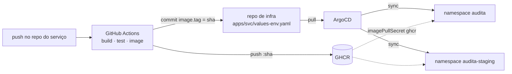
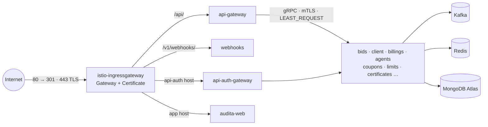

# Kubernetes em produção numa VPS só: GitOps, service mesh e autoscaling

Infraestrutura de uma plataforma SaaS de monitoramento de licitações públicas.
São **17 workloads** (15 serviços Go e 2 front-ends Next.js), mais Kafka, Redis e
observabilidade, rodando em **k3s** numa VPS de 12 GB / 4 vCPU, com **produção e
staging no mesmo cluster**.

Nada aqui é aplicado à mão. O cluster lê este repositório pelo **ArgoCD**, e o
deploy de uma versão nova é um commit que troca a tag da imagem.

> **Sobre os `****`:** este é um espelho público do repositório privado de infra.
> Domínios, e-mails, a organização do GitHub, os endpoints de storage, o host SMTP,
> os identificadores de cluster e todos os valores de Secret foram trocados por
> `****`. O resto (charts, políticas, números de CPU e memória) é o que roda.

---

## Stack

| Camada | Escolha |
|---|---|
| Cluster | k3s (sem Traefik), single node |
| GitOps | ArgoCD: App of Apps + ApplicationSet com git generator |
| Empacotamento | Helm, um chart por serviço, values em camadas por ambiente |
| Service mesh | Istio 1.28 com sidecars nativos, mTLS `STRICT` |
| Borda | Istio IngressGateway + cert-manager (Let's Encrypt, DNS-01) |
| Escala | HPA `autoscaling/v2` por CPU, PDB, `ResourceQuota` |
| Runtime Go | `GOMEMLIMIT` calculado em ~80% do limite de memória do container |
| Registry | GHCR, imagens com tag = SHA do commit, SBOM e provenance |
| CI | GitHub Actions com workflows reutilizáveis (um por tipo de repo) |
| Mensageria / cache | Kafka 4.1 (KRaft, `kafka-native`), Redis 8 |
| Banco | MongoDB Atlas (externo, por causa do Atlas Search) |
| Observabilidade | VictoriaMetrics, VictoriaLogs, Vector, Grafana |
| Backup | CronJob `mongodump` → Cloudflare R2 via rclone, retenção de 30 dias |

---

## 1. GitOps com ArgoCD



A pipeline **nunca recebe credencial do cluster**. Ela só tem permissão de
escrita neste repositório. O deploy é o commit que troca a tag, e o rollback é
um `git revert` desse commit (ou o History na UI do Argo).

**App of Apps.** Um único `root-app` aplicado à mão uma vez aponta para
`argocd/`. A partir dali o próprio ArgoCD gerencia:

| Recurso | O que faz |
|---|---|
| `project.yaml` | `AppProject` que restringe o repositório de origem e os namespaces de destino (`audita`, `audita-staging`, `argocd`, `istio-system`) |
| `applicationset.yaml` | Gera uma `Application` de **produção** para cada diretório em `apps/*` |
| `applicationset-staging.yaml` | O mesmo para **staging**, excluindo `mesh`, `observability` e `mongo-backup`, que são compartilhados ou só existem em produção |
| `base-app.yaml` / `base-staging-app.yaml` | Namespace, `ResourceQuota`, `LimitRange` e `ConfigMap` de cada ambiente |

**Serviço novo não exige mexer no ArgoCD.** Criar `apps/<nome>/` com
`Chart.yaml` e `values.yaml` já basta: o *git directory generator* encontra o
diretório e a `Application` aparece sozinha nos dois ambientes.

**Política de sync:**

```yaml
syncPolicy:
  automated: { prune: true, selfHeal: true }   # o Git é a verdade; drift é desfeito
  syncOptions: [ServerSideApply=true]
  retry: { limit: 5, backoff: { duration: 10s, factor: 2, maxDuration: 3m } }
ignoreDifferences:
  - group: apps
    kind: Deployment
    jsonPointers: [/spec/replicas]              # quem manda nas réplicas é o HPA
```

O `ignoreDifferences` em `/spec/replicas` é o que faz GitOps e HPA conviverem.
O template omite `replicas` quando o autoscaling está ligado, e o ArgoCD não
desfaz o que o HPA decidiu. Isso também permite um `kubectl scale --replicas=0`
no staging inteiro para devolver memória ao nó sem o `selfHeal` religar tudo.

---

## 2. Ambientes: staging e produção

Os dois ambientes vivem no mesmo cluster, separados por namespace. O que muda
entre eles é **um arquivo de values**, não um branch do repositório de infra:

```yaml
helm:
  valueFiles:
    - values.yaml              # base: imagem, env, secretEnv, sidecar, probes
    - values-production.yaml   # ou values-staging.yaml
```

| | Produção | Staging |
|---|---|---|
| Namespace | `audita` | `audita-staging` |
| Branch que dispara o deploy | `main` do serviço | `staging` do serviço |
| Arquivo atualizado pelo CI | `values-production.yaml` | `values-staging.yaml` |
| Réplicas | HPA, de 1–2 até 2–6 | 1, sem HPA |
| `ResourceQuota` (requests) | 3 CPU / 7 Gi, 45 pods | 1,5 CPU / 3 Gi, 24 pods |
| `LimitRange` (máx. por container) | 1536 Mi | 768 Mi |
| Hosts | `api.****`, `app.****` … | `stg-api.****`, `stg-app.****` … |
| Kafka e Redis | próprios | **próprios** |
| Mesh e observabilidade | compartilhados | compartilhados |

**Por que staging tem Kafka e Redis próprios:** os tópicos têm o mesmo nome nos
dois ambientes, e as chaves do Redis não têm prefixo por ambiente. Um staging
apontado para o broker de produção mandaria e-mail de verdade para cliente de
verdade no primeiro evento publicado.

**Por que o front-end tem uma imagem por ambiente:** variáveis `NEXT_PUBLIC_*`
entram no bundle em tempo de build. O workflow `web-app` recebe `build-args` e
`staging-build-args` separados. Sem isso, a imagem de staging sairia apontando
para a API de produção.

---

## 3. Service mesh com Istio: balanceamento real de gRPC e HTTP

### O problema que justifica a malha

Um `Service` ClusterIP balanceia por **conexão** (L4, kube-proxy). gRPC roda
sobre HTTP/2: o cliente abre **uma** conexão longa e multiplexa todas as
chamadas nela. Sem malha, subir um serviço para 3 réplicas dá três pods e uma
fila só, porque a conexão caiu num pod e fica nele.

Com o sidecar Envoy, o HTTP/2 é terminado no proxy e distribuído **por
requisição** (L7). Cada serviço declara a política na sua `DestinationRule`:

```yaml
trafficPolicy:
  loadBalancer:
    simple: LEAST_REQUEST          # o pod com menos chamadas pendentes agora
  connectionPool:
    tcp:  { maxConnections: 64, connectTimeout: 3s }
    http: { http2MaxRequests: 256, maxRequestsPerConnection: 0, maxRetries: 2 }
  outlierDetection:                # pod que devolve 5xx sai do pool
    consecutive5xxErrors: 5
    interval: 10s
    baseEjectionTime: 30s
    maxEjectionPercent: 50
```

`LEAST_REQUEST` em vez de `ROUND_ROBIN` porque o custo das chamadas é desigual:
uma agregação pesada no Mongo e uma leitura por chave não devem pesar igual.

Na prática, **11 serviços gRPC** (porta 9090, `appProtocol: grpc`) e **6
serviços HTTP** (gateways, webhooks, CDN e os front-ends) passam pelo mesmo
mecanismo.

### Borda



- **Um único `Gateway`** atende os hosts dos dois ambientes. A porta 80 só
  redireciona para HTTPS, e o TLS vem de um `Certificate` do cert-manager
  (Let's Encrypt, desafio DNS-01).
- **`VirtualService` por host**, com timeout, retry e CORS na borda. A API faz
  retry em `connect-failure,refused-stream,unavailable`. Webhooks de pagamento
  têm `retries: 0`, porque o provedor já reenvia e retry na borda geraria
  processamento duplicado.
- Os hosts de staging roteiam para o FQDN `*.audita-staging.svc.cluster.local`.

### Malha enxuta para caber numa VPS

O padrão do Istio é 100m / 128 Mi **por sidecar**. Com 23 pods na malha, só os
sidecars levariam quase 3 GiB. Os ajustes:

| Ajuste | Onde | Efeito |
|---|---|---|
| Sidecar 25m / 48 Mi (limite 200m / 192 Mi) | anotações `sidecar.istio.io/proxy*` no pod | ~1 GiB de sidecar no total em vez de ~3 GiB |
| Recurso `Sidecar` restringindo egress a `./*` e `istio-system/*` | `apps/mesh/templates/policy.yaml` | o proxy carrega a config só do próprio namespace |
| `ENABLE_NATIVE_SIDECARS=true` | `istiod` | o sidecar vira init container nativo: **CronJobs na malha terminam** em vez de ficar presos no proxy |
| `holdApplicationUntilProxyStarts` | `meshConfig` | a app não sobe antes do proxy, então a primeira chamada gRPC não falha |
| Porta de métricas fora da interceptação | `traffic.sidecar.istio.io/excludeInboundPorts` | probes e scrape batem direto no processo |
| Kafka, Redis, observabilidade e backup fora da malha | `sidecar.istio.io/inject: "false"` | protocolo TCP sem ganho de L7, ~100 Mi a menos |

Segurança da malha: `PeerAuthentication` em **mTLS `STRICT`** no namespace
inteiro. Nenhum pod aceita tráfego em texto puro de outro pod.

---

## 4. HPA: escalando pods extras

Todo serviço de produção, exceto um, tem `HorizontalPodAutoscaler`
(`autoscaling/v2`) por utilização de CPU:

| Serviço | Mín → máx | Alvo de CPU |
|---|---:|---:|
| api-gateway, client | 2 → 6 | 70% |
| bids | 2 → 5 | 70% |
| audita-web, billings, api-auth-gateway | 2 → 4 | 70% |
| webhooks, limits | 2 → 4 | 75% |
| agents | 1 → 3 | 60% |
| cdn, mailer | 1 → 3 | 70% |
| automations, coupons, certificates | 1 → 3 | 75% |
| whitelabel, audita-landing | 1 → 2 | 80% |
| pncp | **1 fixo** | — |

```yaml
behavior:
  scaleUp:   { stabilizationWindowSeconds: 30,  policies: [{ type: Pods, value: 1, periodSeconds: 60 }] }
  scaleDown: { stabilizationWindowSeconds: 300, policies: [{ type: Pods, value: 1, periodSeconds: 120 }] }
```

Sobe rápido, um pod por minuto. Desce devagar, depois de 5 minutos estável e
um pod a cada 2 minutos, para não oscilar em tráfego com rajadas.

**Decisões:**

- **CPU, nunca memória.** O heap do Go não devolve memória de forma previsível,
  e com `GOMEMLIMIT` o processo trabalha de propósito perto do teto. Um HPA por
  memória subiria e ficaria preso no máximo.
- **`pncp` sem HPA.** O rate limiter contra a API pública do governo vive na
  memória do processo. Duas réplicas dobrariam a taxa de chamadas. O HPA só será
  ligado quando o limitador for para o Redis.
- **O HPA não derruba o nó.** A `ResourceQuota` do namespace é o teto conjunto:
  16 autoscalers não se coordenam entre si, e o pod que estouraria a quota fica
  `Pending` em vez de levar o nó a OOM. O sistema degrada em vez de quebrar.
- **Rollout sem janela:** `maxSurge: 1, maxUnavailable: 0`, `PodDisruptionBudget`
  (`maxUnavailable: 1`) nos serviços do caminho crítico (gateways, webhooks,
  bids, client, billings, web) e `topologySpreadConstraints` por hostname, que
  já espalham as réplicas no dia em que existir um segundo nó.

---

## 5. `GOMEMLIMIT`: pressionando o GC antes do OOMKill

Sem `GOMEMLIMIT`, o GC do Go dispara pelo `GOGC=100` (quando o heap dobra) e não
sabe que existe um limite de cgroup. Um pico de alocação passa do `limits.memory`
antes do GC acordar, e o kernel mata o container.

Com `GOMEMLIMIT`, o runtime passa a conhecer o teto e o GC fica **mais
agressivo à medida que o heap se aproxima dele**. Aqui o valor é sempre ~80% do
limite do container, e os 20% restantes ficam para o que não é heap: stacks de
goroutine, estruturas do runtime e buffers.

| Workload | `limits.memory` | `GOMEMLIMIT` |
|---|---:|---:|
| agents | 1 Gi | 819 MiB |
| bids | 768 Mi | 614 MiB |
| api-gateway, client, billings | 384 Mi | 307 MiB |
| api-auth-gateway, webhooks | 256 Mi | 204 MiB |
| mailer, coupons, limits … | 192 Mi | 153 MiB |
| bids (staging) | 384 Mi | 307 MiB |
| CronJob `collect-bids` | 1 Gi | 819 MiB |

O valor é injetado como env no Deployment (`{{ .Values.goMemLimit }}`), muda por
ambiente junto com o limite, e **cada CronJob tem o seu**, porque um job de
coleta tem um perfil de memória diferente do servidor que divide a imagem com ele.

Para os front-ends Node, o equivalente é `NODE_OPTIONS=--max-old-space-size`.

---

## 6. ConfigMaps, envs e Secrets

A configuração chega ao pod por três camadas, todas declaradas no chart:

```yaml
# values.yaml de um serviço
env:                              # 1. específico do serviço, em texto
  DB_NAME: "bids"
  CLIENT_HOST: "client:9090"      #    service discovery pelo DNS do cluster
  MAILER_HOST: "mailer:9090"

secretEnv:                        # 2. VAR_DE_AMBIENTE: chave-no-Secret
  MONGODB_URL: mongodb-url
  REDIS_PASSWORD: redis-password
```

```yaml
# templates/deployment.yaml
env:
  - name: GOMEMLIMIT
    value: {{ .Values.goMemLimit | quote }}
  {{- range $k, $v := .Values.env }}
  - name: {{ $k }}
    value: {{ $v | quote }}
  {{- end }}
  {{- range $k, $v := .Values.secretEnv }}
  - name: {{ $k }}
    valueFrom:
      secretKeyRef: { name: audita, key: {{ $v }} }
  {{- end }}
envFrom:
  - configMapRef: { name: audita-config }   # 3. compartilhado do ambiente
```

| Camada | O que guarda | Onde vive |
|---|---|---|
| `ConfigMap audita-config` | Endereços de Kafka e Redis, URLs públicas do front, auth e CDN | `base/` e `base-staging/`, um por namespace |
| `env` | Nome do banco, endereços dos serviços vizinhos | `values.yaml` do chart |
| `secretEnv` → `Secret audita` | Credenciais de banco, gateway de pagamento, LLM, SMTP, storage | **fora do Git** |

- **Cada serviço só recebe as chaves que declara.** O Secret é um só, mas o
  `api-gateway` não vê o token do gateway de pagamento, e o `mailer` não vê a URL
  do banco.
- **O Secret nunca é commitado.** `base/secret.example.yaml` documenta as chaves
  (com `****` aqui) e é excluído do sync do ArgoCD (`directory.exclude`). O valor
  real é criado no cluster no bootstrap.

---

## 7. GHCR: de onde as imagens vêm

- O CI publica em `ghcr.io/****/<serviço>` com o `GITHUB_TOKEN` do próprio
  repositório (`packages: write`). A tag é **o SHA completo do commit**, nunca
  `latest`: se a tag não muda, o manifesto não muda e o ArgoCD não tem o que
  sincronizar.
- Cada imagem sai com **SBOM e provenance** (`mode=max`), e o build usa cache do
  GitHub Actions.
- Módulos Go privados entram no build via **BuildKit secret**
  (`--mount=type=secret,id=gh_token`), sem token gravado em camada da imagem.
- No cluster, um secret `docker-registry` chamado `ghcr` em cada namespace
  (`scripts/create-ghcr-secret.sh`, que também cobre a rotação do token) é
  anexado ao **ServiceAccount** de cada serviço:

```yaml
apiVersion: v1
kind: ServiceAccount
automountServiceAccountToken: false
imagePullSecrets:
  - name: ghcr
```

Como o secret está no ServiceAccount, Deployments **e** CronJobs do serviço
puxam a imagem privada sem repetir a configuração. O token da API do Kubernetes
não é montado, porque nenhum serviço fala com o apiserver.

---

## 8. Jobs por CronJob

Rotinas periódicas usam **a mesma imagem do serviço**, chamando um binário de
CLI (`bids-cli collect-bids`). Elas são declaradas como lista no values, e o
template gera um `CronJob` para cada item:

```yaml
cronjobs:
  - name: collect-bids
    command: collect-bids
    schedule: "0 7,14,20 * * *"
    deadline: 3600
    goMemLimit: "819MiB"
    resources: { requests: { cpu: 100m, memory: 256Mi }, limits: { cpu: "1", memory: 1Gi } }
```

| CronJob | Agenda (America/Sao_Paulo) | O que faz |
|---|---|---|
| `bids-collect-bids` | 07h, 14h, 20h | Coleta licitações da API pública |
| `bids-send-recommendations` | 08h, 15h, 21h | Casa as licitações novas com o perfil de cada cliente e notifica |
| `client-expire-tastings` | 03h | Expira períodos de teste |
| `client-alert-companies` | 12h | Avisa as empresas em período de teste (uma vez por dia **de propósito**, porque rodar de novo reenviaria tudo) |
| `certificates-expiring-alert` | 09h | Avisa certidões perto do vencimento |
| `mongo-backup` | 04h | `mongodump` → R2, retenção de 30 dias |

Configuração comum:

```yaml
timeZone: America/Sao_Paulo
concurrencyPolicy: Forbid        # nunca duas execuções sobrepostas
startingDeadlineSeconds: 300
jobTemplate:
  spec:
    backoffLimit: 0              # job que manda e-mail não pode repetir sozinho
    activeDeadlineSeconds: …     # teto de duração por job
```

- `backoffLimit: 0` nos jobs de notificação, porque um retry automático mandaria
  o mesmo e-mail duas vezes. O `mongo-backup`, que é idempotente, usa
  `backoffLimit: 2`.
- O **backup** é um pod com duas etapas: um `initContainer` com `mongodump
  --gzip` grava num `emptyDir`, e o container principal faz `rclone copy` para
  um bucket S3-compatível, depois `rclone delete --min-age 30d`. As credenciais
  vêm do Secret, e o filesystem é read-only nos dois.
- A `ResourceQuota` também limita a quantidade de CronJobs: `count/cronjobs.batch: "6"`.

---

## 9. Governança de recursos

Três camadas, da mais específica para a mais geral:

| Camada | Protege contra |
|---|---|
| `limits` por container | Um serviço com vazamento comendo o nó |
| `GOMEMLIMIT` (~80% do limite) | O GC acordar tarde demais e virar OOMKill |
| `ResourceQuota` do namespace | **Vários HPAs escalando juntos** |

Mais um `LimitRange` por namespace, que dá request e limit padrão a qualquer
container que esqueça de declarar.

A conta inteira (o que o sistema operacional, o k3s, o istiod e o ArgoCD consomem,
quanto sobra para escala e page cache e por que staging pede 16 GB) está em
[`CAPACIDADE.md`](CAPACIDADE.md), medida com `helm template` em todos os charts.

---

## 10. Hardening dos pods

Todo workload de aplicação roda com:

```yaml
securityContext:                       # pod
  runAsNonRoot: true
  runAsUser: 65532                     # nonroot do distroless
  fsGroup: 65532
  seccompProfile: { type: RuntimeDefault }
containers:
  - securityContext:
      allowPrivilegeEscalation: false
      readOnlyRootFilesystem: true     # escrita só em emptyDir /tmp com sizeLimit
      capabilities: { drop: ["ALL"] }
```

Probes separadas em porta própria de métricas (`19090`): `startupProbe` e
`livenessProbe` em `/health`, `readinessProbe` em `/ready`.

---

## 11. Observabilidade

| Componente | Papel |
|---|---|
| **VictoriaMetrics** | Scrape dos pods via `kubernetes_sd`, retenção de 3 meses |
| **VictoriaLogs** | Logs com 7 dias de retenção, endpoint compatível com Elasticsearch |
| **Vector** (DaemonSet) | Coleta `kubernetes_logs` de cada nó e envia ao VictoriaLogs |
| **Grafana** | Datasources provisionados por ConfigMap |

A stack pede ~830 Mi de request e fica fora da malha. Ela existe uma vez só no
cluster e não é duplicada em staging.

---

## 12. CI

| Workflow | Quem chama | Etapas |
|---|---|---|
| `go-service.yaml` | os 15 serviços Go | build · `go test -race -shuffle=on` com cobertura · imagem · bump da tag |
| `web-app.yaml` | os 2 front-ends | `bun install --frozen-lockfile` · lint · `tsc --noEmit` · imagem · bump da tag |
| `ci.yaml` | este repositório | `helm lint` + `helm template \| kubeconform -strict` em todos os charts |

Os repositórios de código não têm pipeline próprio. Cada um tem um `ci.yaml` de
poucas linhas que chama um workflow reutilizável daqui (`workflow_call`), então
trocar a versão do Go ou o passo de deploy é uma edição só.

O job de deploy tem `concurrency` por chart e faz `pull --rebase` com até 5
tentativas no push, para que deploys simultâneos de serviços diferentes não
briguem pelo mesmo `main`.

---

## Bootstrap

A ordem importa, e cada passo é pré-requisito do seguinte:

```bash
./scripts/bootstrap-k3s.sh          # k3s SEM Traefik (o Istio ocupa 80/443) + ArgoCD
kubectl -n cert-manager create secret generic cloudflare-api-token ...
./scripts/bootstrap-istio.sh        # cert-manager, ClusterIssuer, istio-base, istiod, ingressgateway
kubectl -n audita create secret generic audita ...                    # Secret fora do Git
GHCR_USER=... GHCR_TOKEN=... ./scripts/create-ghcr-secret.sh
kubectl apply -f argocd/root-app.yaml                                 # daqui em diante é o ArgoCD
```

O Istio vem antes do `root-app` porque os charts criam `Gateway`,
`VirtualService` e `DestinationRule`, e sem os CRDs o sync falha.

**Local:** `scripts/bootstrap-k3s-local.sh` sobe a mesma coisa em **k3d** (k3s
dentro do Docker), com certificado autoassinado. `STAGING=1` inclui o segundo
ambiente, e `MINIMAL=1` sobe só o cluster e o ArgoCD.

---

## Trade-offs conhecidos

Um case honesto inclui o que ainda não está resolvido:

| Hoje | Por quê | Próximo passo |
|---|---|---|
| Um nó só | Custo | `topologySpreadConstraints` já estão nos charts. Um segundo nó espalha as réplicas sem mudar nenhum chart |
| Secret criado à mão no bootstrap | Simplicidade inicial | Sealed Secrets ou External Secrets, para o Secret também virar GitOps |
| `pncp` em 1 réplica | Rate limiter em memória | Limitador no Redis, depois HPA |
| HPA do `agents` por CPU | O pod passa a maior parte do tempo esperando a API do LLM, com CPU perto de zero | Escalar por profundidade de fila (KEDA) ou consumir a análise via Kafka |
| Kafka com 1 broker | Cabe na VPS | Réplicas e `min.insync.replicas` quando houver mais de um nó |

---

## Estrutura

```
.
├── argocd/              App of Apps, AppProject, ApplicationSets (prod e staging)
├── base/                namespace, quota, limitrange, configmap de produção
├── base-staging/        o mesmo para staging
├── apps/
│   ├── <serviço>/       Chart + values.yaml + values-production.yaml + values-staging.yaml
│   ├── mesh/            Gateway, Certificate, VirtualServices, PeerAuthentication, Sidecar
│   ├── kafka/ redis/    dependências in-cluster
│   ├── observability/   VictoriaMetrics, VictoriaLogs, Vector, Grafana
│   └── mongo-backup/    CronJob de backup
├── atlas/               definição versionada do índice do Atlas Search
├── scripts/             bootstrap do k3s, do Istio, local (k3d) e secret do GHCR
├── .github/workflows/   workflows reutilizáveis e validação dos charts
└── CAPACIDADE.md        a conta de CPU e memória por trás de cada número
```
# kubenertes-gitops-architecture
